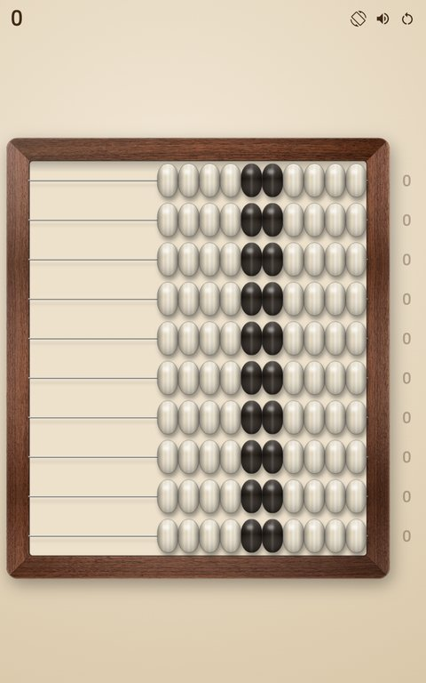
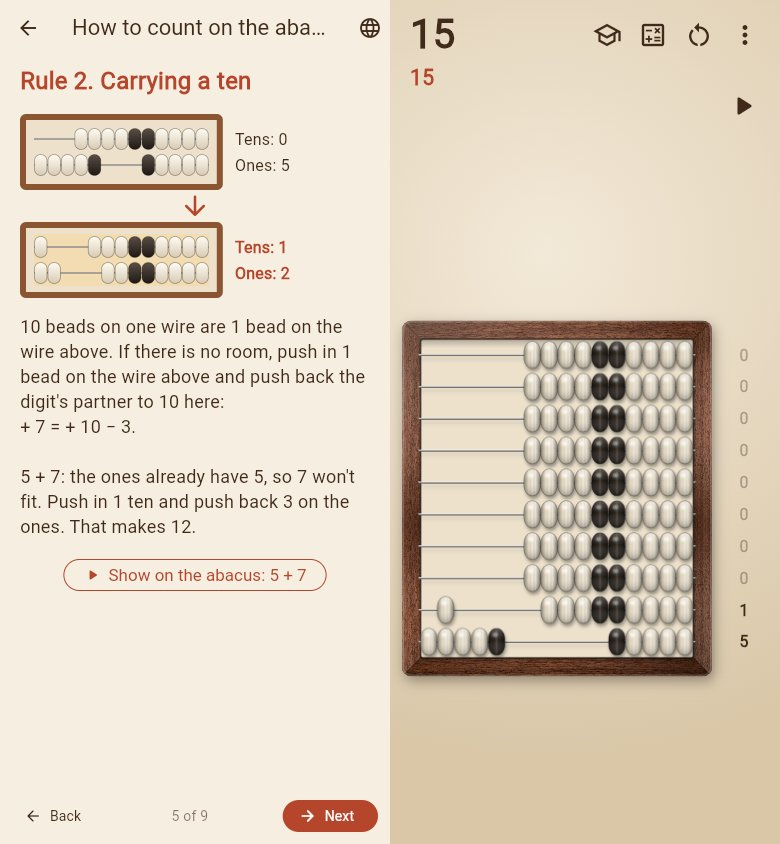
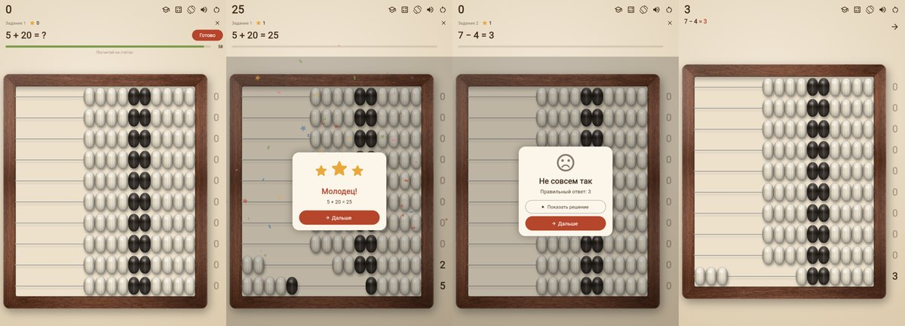

# GoAbacUs

**A learning abacus for kids 6+.** A realistic wooden school abacus (Russian *schoty*) with
real physics and sound, step-by-step examples and school exercises in addition and subtraction.
Fully offline: no accounts, no ads, no tracking.

Android first, iOS next. Built with Flutter.
UI languages: English, Deutsch, Français, Español, Русский.

<p>
  
  
</p>


## Features

- **Feels like a real abacus.** 10 wires of 10 beads with two dark beads in the middle.
  Beads have inertia and friction, knock against each other and the frame with real recorded
  clicks, and get heavier the more of them you push. Tilt the tablet and they slide.
  Gentle vibration when beads hit the frame.
- **Live notation.** The number on the abacus and each row's digit are read from the beads;
  every change you make is written down as an expression: `3 + 20 − 3 = 20`.
- **Watch an example.** Type an example and an invisible finger solves it on the abacus,
  digit by digit, carrying and borrowing the school way (`+ 7 = + 10 − 3`), with a comment on every move.
- **Tutorial** with four rules: adding, carrying, subtracting, borrowing.
- **Exercises**: addition, subtraction or both; easy (up to 99, no carry) or harder (up to 999,
  with carry). Stars and confetti for a right answer, the worked solution for a wrong one.

## Install

- **Google Play:** coming soon.
- **Android APK:** download from [Releases](https://github.com/mgubko/GoAbacUs/releases),
  or the `goabacus-debug-apk` artifact of the latest
  [Android build](https://github.com/mgubko/GoAbacUs/actions/workflows/android.yml) run.
- **iPad / iPhone:** unsigned `.ipa` from the
  [iOS build](https://github.com/mgubko/GoAbacUs/actions/workflows/ios.yml) workflow,
  to sideload with Sideloadly or AltStore.

## Build from source

```bash
flutter pub get
flutter test
flutter run            # on a connected tablet or phone
```

CI (`.github/workflows/android.yml`) builds a debug APK on every push and a signed AAB + APK
for Google Play on a `v*` tag. Signing setup is described in Russian below
(*Подпись релиза*): run `tool/make_upload_key.sh` once and add the four
`ANDROID_KEY*` secrets.

## Privacy

GoAbacUs collects no data and has no Internet access in release builds.
See the [Privacy Policy](https://mgubko.github.io/GoAbacUs/privacy.html)
([source](docs/privacy.html)).

## License

Code is released under the [MIT License](LICENSE).

Assets: bead and wood textures (`assets/images/`) and the app icon were generated for this
project; `success.wav` and `fail.wav` are synthesized by `tool/gen_cues.py`.
The bead click, slide and spin sounds (`assets/sounds/bone_*`, `wood_*`, `slide`, `rattle`,
`spin_*`) are cut by `tool/cut_sounds.py` from a recording of a wooden abacus,
the YouTube video [0fO-HlM-gLU](https://www.youtube.com/watch?v=0fO-HlM-gLU) by
**SV DATA** ([youtube.com/@svdataSound](https://www.youtube.com/@svdataSound)), published as
“Sounds, music, videos, no copyright.” Thank you, SV DATA!

## Credits

- Abacus sounds: [SV DATA](https://www.youtube.com/@svdataSound), video
  [0fO-HlM-gLU](https://www.youtube.com/watch?v=0fO-HlM-gLU).
- Built with [Flutter](https://flutter.dev) and the packages listed in `pubspec.yaml`
  (`sensors_plus`, `audioplayers`, `vibration`, `shared_preferences`, `intl`).

---

## По-русски

Учебные счёты для младших школьников: планшет и телефон (Android, затем iOS), без интернета.
Ребёнок двигает костяшки пальцами и наклоном устройства, а приложение показывает число.

### Что уже есть

- 10 спиц по 10 костяных костяшек, две чёрные в середине; единицы на нижней спице.
- Физика (`lib/physics/abacus_physics.dart`, единицы СИ): инерция, трение покоя и скольжения,
  упругие удары кость–кость и кость–рамка, палец как пружина с ограниченной силой
  (чем больше костяшек толкаешь, тем они тяжелее и медленнее), гравитация от наклона.
- Звуки ударов вырезаны из записи настоящих деревянных счётов (видео
  [0fO-HlM-gLU](https://www.youtube.com/watch?v=0fO-HlM-gLU) канала
  [SV DATA](https://www.youtube.com/@svdataSound), «no copyright»): `tool/cut_sounds.py`.
  Громкость зависит от скорости удара, звук только при новом ударе.
- Вибрация при ударе о рамку, сила по импульсу движущейся группы.
- Вертикальный взмах пальцем по рядам крутит костяшки на спицах: звук из той же записи
  (`spin_*.wav`), громкость растёт как log(f·n), f — скорость в спицах в секунду, n — число задетых спиц.
- Текстуры дерева и кости сгенерированы Gemini: `assets/images/`.
- Число на счётах и цифра каждого ряда считываются по положению костяшек.
- **Запись** (`lib/arith/tape.dart`): когда костяшки замирают на новом числе на 1,5 с,
  изменение записывается в ленту: `3 + 20 − 3 = 20`.
- **Показ примера** (`lib/arith/plan.dart`, `lib/arith/player.dart`): пример с клавиатуры
  (кнопка-калькулятор) или из ленты проигрывается «невидимым пальцем» через ту же физику,
  со звуком. Разряды от старшего к младшему, перенос и заём по-школьному:
  `+ 7 = + 10 − 3`, `− 7 = − 10 + 3`; подпись к каждому шагу и подсветка ряда.
- **Задания** (`lib/arith/exercise.dart`, `lib/ui/exercise_ui.dart`): сложение, вычитание
  или всё вместе; простые (до 99, без переноса) или с переносом (до 999). Минута на задание,
  ответ засчитывается, когда костяшки замрут на нём, или по кнопке «Готово».
  Звёзды и конфетти за верный ответ, грустная мордочка и «Показать решение» за неверный.
  Звуки наград: `tool/gen_cues.py`.

### Сборка

```bash
flutter pub get
flutter test
flutter run                 # на подключённом планшете
```

### GitHub Actions

`.github/workflows/android.yml`:

- каждый push и PR: анализ, тесты и **debug APK** (артефакт `goabacus-debug-apk`);
- тег `v1.2.3` или ручной запуск: **подписанные AAB (для Google Play) и APK**,
  артефакт `goabacus-release`; для тега ещё и GitHub Release с файлами.

#### iPad / iPhone

`.github/workflows/ios.yml` собирает **неподписанный .ipa** (артефакт
`goabacus-ios-unsigned`) по тегу `v*` или вручную: *Actions → iOS build → Run workflow*.
macOS-сборка в приватном репозитории тратит минуты Actions в 10 раз быстрее, поэтому не на каждый push.

Установить неподписанный .ipa на iPad можно через Sideloadly или AltStore с вашим Apple ID
(бесплатный аккаунт: приложение работает 7 дней, потом переустановить).
Для TestFlight и App Store нужен Apple Developer Program, тогда добавим подпись в CI.

#### Подпись релиза (Release signing)

1. Один раз создайте ключ загрузки: `tool/make_upload_key.sh` (нужен JDK).
   Сохраните `.jks` и пароль в надёжном месте, в репозиторий их не кладите.
2. Добавьте секреты в *Settings → Secrets and variables → Actions*:
   `ANDROID_KEYSTORE_BASE64`, `ANDROID_KEYSTORE_PASSWORD`, `ANDROID_KEY_ALIAS`, `ANDROID_KEY_PASSWORD`.
3. Выпуск версии: `git tag v0.1.0 && git push origin v0.1.0`.

В Google Play включите Play App Signing: Google хранит ключ подписи приложения,
а этот ключ используется только для загрузки.
